# Sinag, by Chrys

**A small floating window that turns Claude Code into a software team** — Sinag leads it, with a
Developer, a Tester and, with a subscription, a Designer — working on your own project, on your own PC.

*Sinag* is Tagalog for "ray of light".

## Download

Get **`sinag-installer.exe`** from the [latest release](https://github.com/chrysanly/sinag-agents/releases/latest)
and run it. It installs for your Windows account only (no admin needed), and Sinag keeps itself
up to date from this page afterwards.

## How it works

  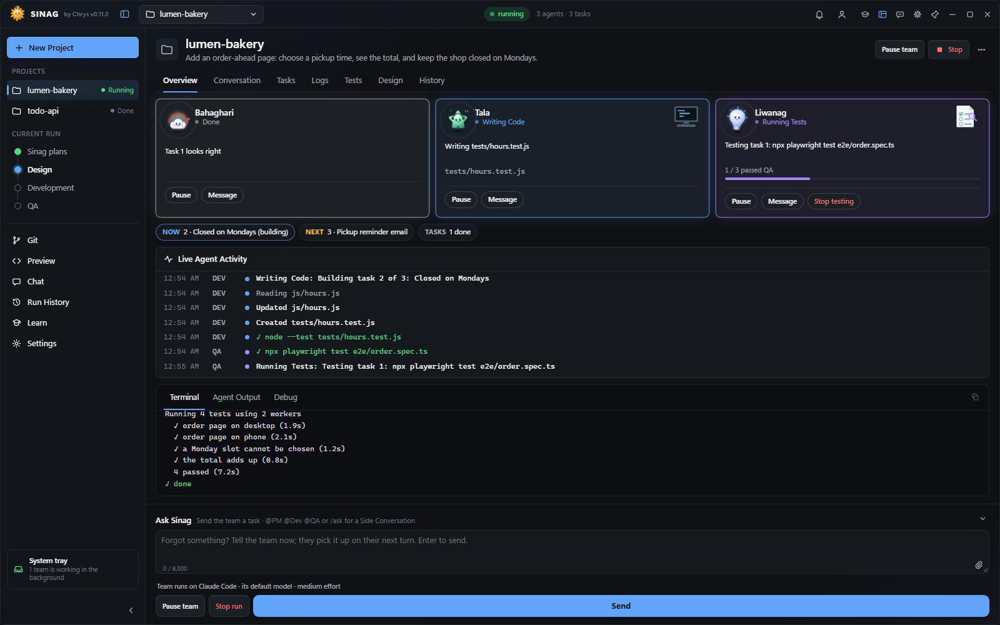

1. **Add a project folder** and describe what you want, in plain words. Paste screenshots if they help.
2. **You and Sinag talk it through.** Sinag checks your project, tells you whether it can be done
   and who would do what, and asks whether it should be tested. What you agree is written down and
   shown on the plan, which waits for your **Begin**.
3. **Small change? Sinag can do it herself.** When the plan is a few lines in one or two files, she
   offers to make it herself and run the tests, with no other agent. One tick on the plan gives it
   to the team instead.
4. **The designer designs first** (with a subscription). For every task that changes what you see,
   **Bahaghari** makes a real mockup of the screen, on desktop and phone. You **Approve** it or say
   what to change, and open it live to try its hover and motion. Each task is built as soon as its
   own design is approved, so one design you send back never holds up the rest. Want every screen
   settled first? Turn on **Design first** under the box: you talk it through with Sinag, Bahaghari
   designs every screen, and nothing is built until you have approved them all.
5. **The developer builds it, the tester tests it.** **Tala** builds each task to match the design;
   Bahaghari checks the result looks like the mockup; **Liwanag** tests that it works, on desktop
   and phone. Rename any of them in **Settings → Team & runs**.
6. **You get a report** from whoever worked last: what was done, what was verified and what wasn't,
   what needs you, and a screenshot of the result. Add another task to the same run from the box
   under it, or start a new run.

  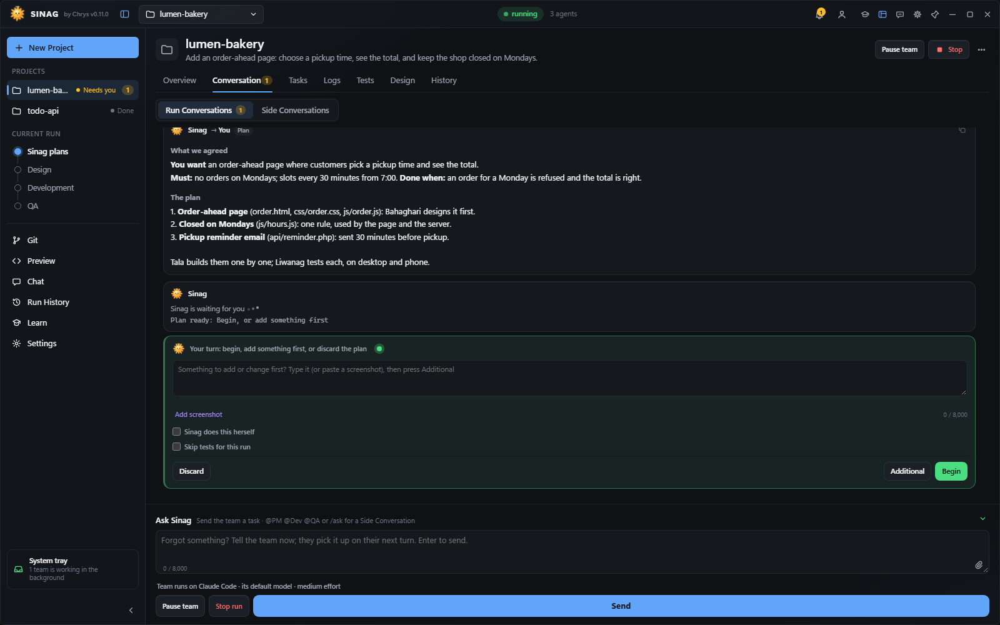

  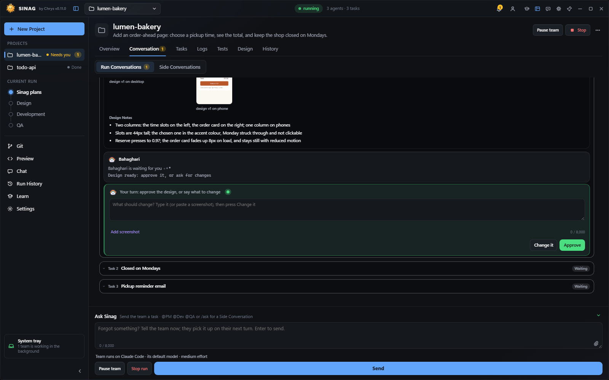

  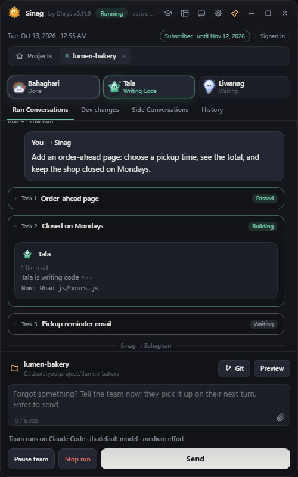
  &nbsp;
  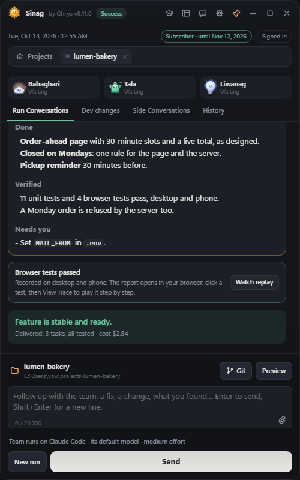

**Steer the team while it works** (with a subscription). Right-click an agent to message it, pause
it or stop the run. Every message shows whether it is waiting, being worked on or done. Type
**@Sinag**, **@Tala** or **@Liwanag** (or **@PM**, **@Dev**, **@QA**) for a side conversation that
never stops the run.

  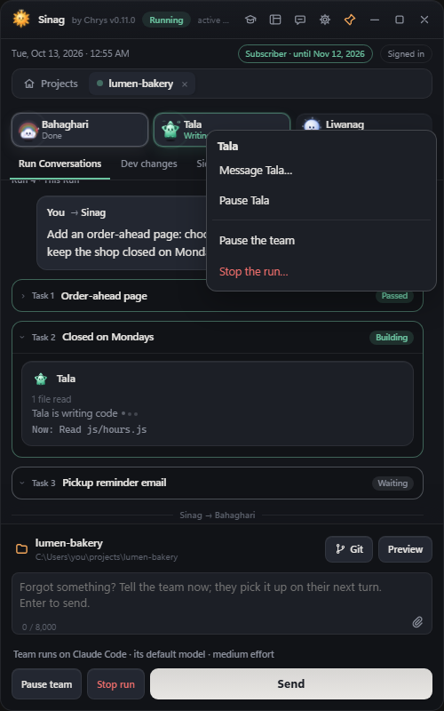
  &nbsp;
  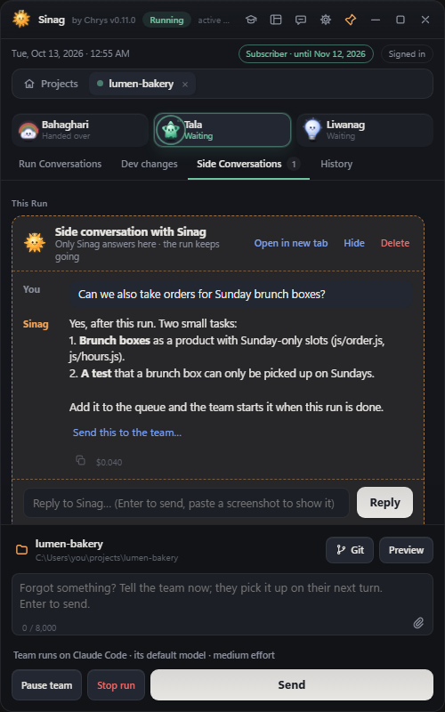

**Every design, kept.** Every version Bahaghari makes is kept in your project, across runs, approved
or not. The **Design** tab lists them by name: click one to open it, click its folder to show it in
Explorer, or delete the ones you no longer need to save space. It also shows each review of what was
built, with the screenshots, and the app Sinag started for the designer.

  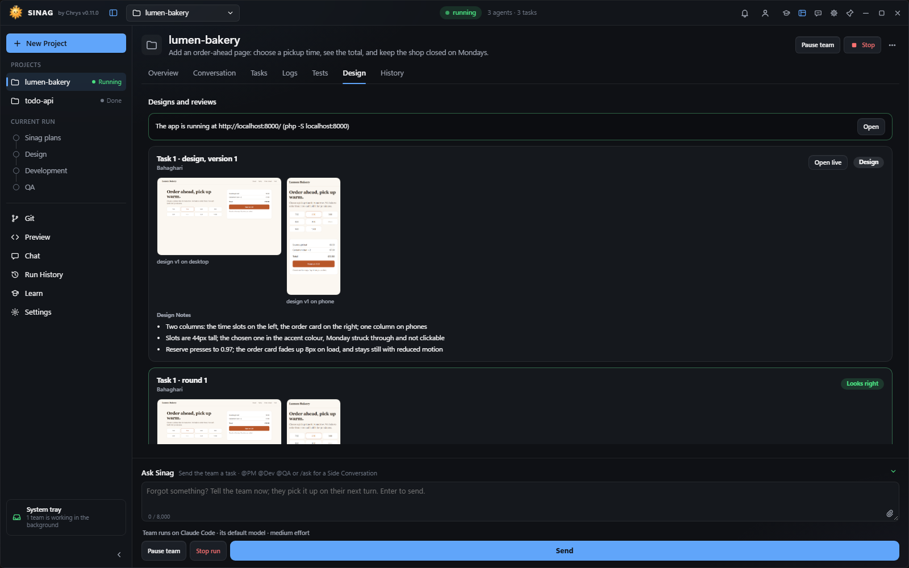

**Every run, kept.** History lists each run with its result, cost, screenshots and side
questions, and reopens any of them.

  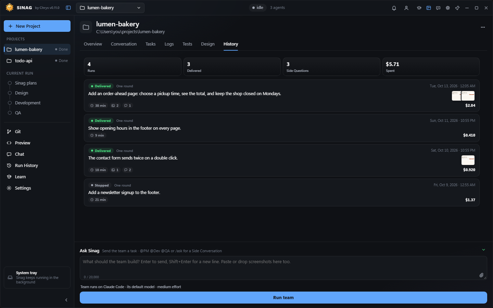

  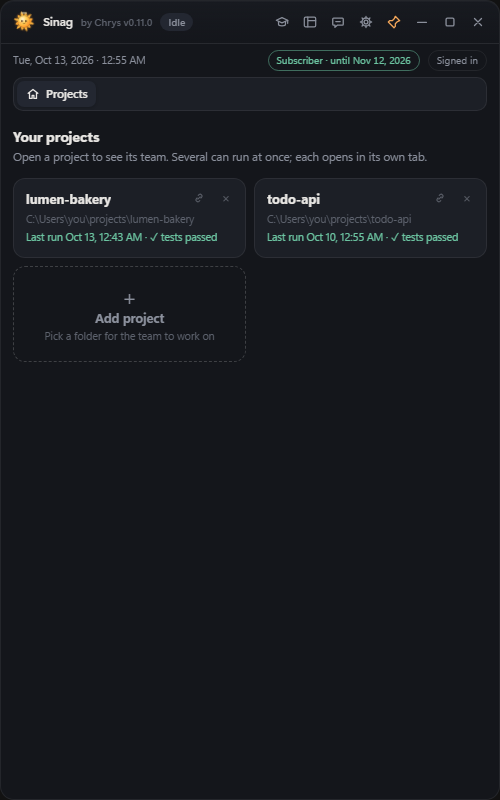
  &nbsp;
  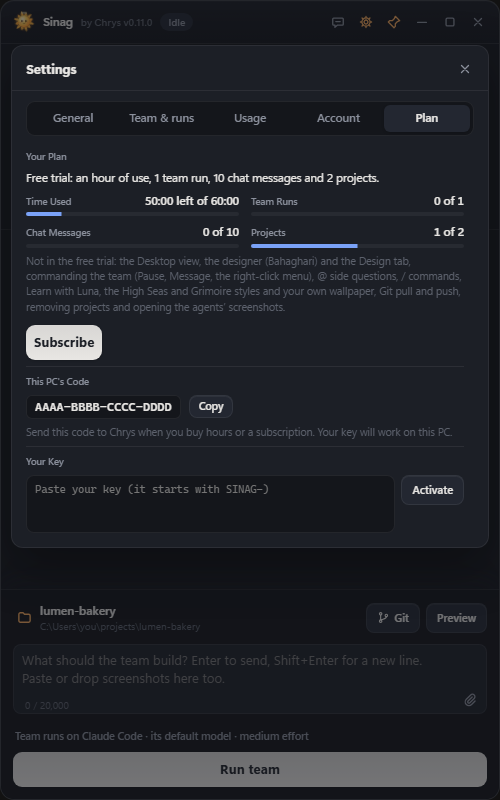

*Screenshots of Sinag 0.11.0 with a demo project and made-up data.*

## Free trial and subscription

Sinag starts with a **free trial**. A **subscription key** lifts every limit and adds the rest.
The clock and what is left show in the window and in **Settings → Plan**.

| | Free trial | Subscription |
|---|---|---|
| **Time** | 1 hour of use (counted only while Sinag is open and in use) | As long as your key runs: a number of days, or hours of use |
| **Team runs** | 1 | Unlimited |
| **Chat messages** | 10 | Unlimited |
| **Projects** | 2 (can't be removed during the trial) | Unlimited, and remove any |
| **The team**: Sinag, the developer and the tester, talking it through, the plan, the report | ✓ | ✓ |
| **Sinag makes small changes herself** | ✓ | ✓ |
| **Tests, preview, browser-test replay, History, Chat** | ✓ | ✓ |
| **Choose your AI**: your Claude plan, an API key, OpenCode Zen | ✓ | ✓ |
| **Sinag, Aurora and Paper styles**, light and dark | ✓ | ✓ |
| **The Desktop view** (full workspace) | | ✓ |
| **The designer, Bahaghari**: mockups first, Open live, the Design tab | | ✓ |
| **Steer the team**: Pause, Message, the right-click menu | | ✓ |
| **@ side conversations** and **/ commands** | | ✓ |
| **Open the agents' screenshots** | | ✓ |
| **Learn with Luna**: learning paths with a mentor | | ✓ |
| **High Seas and Grimoire styles**, and your own wallpaper | | ✓ |
| **GitHub**: pull and push from Sinag | | ✓ |

**Getting a key:** send Chrys the code shown under **This PC's code** (Settings → Plan, or on the
key screen) and you get a key for that PC, for a number of days or hours of use. Hours count only
while Sinag is in use, and a new key adds its hours to what you have left.

## Requirements

| What | Details |
|---|---|
| **Windows 10 or 11, 64-bit** | Installs for your account only, no admin rights. About 50 MB. |
| **An AI to run on** | Your Claude plan (Pro, Max, Team or Enterprise), an Anthropic API key, or OpenCode Zen credits; Free usage too, for Learn paths. Connect each once in Settings → Usage and switch any time. Usage counts against that account; each run has a spend limit you set. |
| **Claude Code** | The first-start setup checks for it and installs it with Anthropic's official installer if it's missing. Signing in to Claude is only needed when you run on your Claude plan. |
| **Internet** | To reach your AI, and for Sinag's updates. |
| **Node.js** *(web projects only)* | For the tester's browser tests and their replay. Playwright is added to the project the first time, and you're asked before it installs. |

Everything else ships inside Sinag: its own Python, and the Microsoft Edge WebView that Windows
already has (the installer adds it if it's missing).

## What Sinag does

**You describe the work, the team delivers it.**
- **Talk it through first.** When you press Run, Sinag checks your project and tells you whether it
  can be done here, what she understood, who would do what and what she needs from you. Reply as
  many times as you like; the plan comes only when you choose **Write the plan**, or **Stop** to
  end there. Turn it off in Settings → Team & runs (**Discuss with the PM before the plan**).
- **What you agreed is kept.** Sinag always asks whether it should be tested or it's dev work only,
  and writes down what you agreed: what you want, must and must-not, how to tell it's done, and
  your decisions. It sits at the top of the plan card so you can correct it, and the team works
  from it.
- **The plan waits for you.** Nothing is built until you choose **Begin**; choose **Additional** to
  add something and Sinag updates the plan first, or **Discard** to drop it. Tick **Skip tests for
  this run** when you don't need tests this time.
- **Sinag does small changes herself.** When a change is small (a few lines, nothing to design, low
  risk) she offers to make it herself, with the developer's permissions for that change only, and
  runs your tests; pass or fail is the test's own result. Untick **Sinag does this herself** and the
  team does it.
- **The designer designs first** (with a subscription). For a task that changes what you see,
  Bahaghari makes a mockup of the finished screen in your project's own colours, fonts and
  components, with its states and motion, and screenshots it on desktop and phone. **Open live**
  opens the real mockup so you can hover, click and resize it. **Approve** it, or type what to
  change (a screenshot helps) and press **Change it** for a new version. Versions keep counting
  across runs, and the project's brain notes what was designed, approved and sent back. The
  developer starts a task as soon as its design is approved, builds to it, Bahaghari checks the result matches (up to 3 rounds), and only then is it
  tested. Small visual tweaks don't need a mockup; Sinag can do those herself.
- **Developer**, a senior full-stack engineer, builds it in your project folder the way your stack
  is meant to be written, and writes the unit tests and (for websites) the browser tests at
  desktop and phone sizes. It runs the tests for its change and your project's own checks (lint,
  type-check, build), fixes what fails and runs them again (up to 3 times) before handing over.
- **Tester** only tests, never codes: it runs the tests for what changed and the code linked to
  it, and checks pages on desktop and phone. A bug opens a thread on that task, where the tester
  and the developer sort it out (up to 3 rounds). Nice-to-have ideas come to you in the report.
- **Task by task.** Sinag splits the work into tasks; tasks that change the same files go
  together. The developer builds them one after another while the tester tests each finished one
  straight away, so they work at the same time.
- When every task is done, the whole suite runs once. **The run passes only when the tests pass**
  — never on the model's word.
- At the end, whoever worked last reports to you: what was done, what was verified and what
  wasn't, what needs you, and a screenshot of the result when the project has a page to show.
- **One run, several rounds.** Under the report, **Add another task to this run** continues the same
  conversation, and History keeps it as one run.

**Built-in expertise.** Every agent comes with a curated, security-reviewed set of skills it uses
when the task calls for it:
- **Engineering:** architecture and feature planning, test-first building, root-cause debugging,
  and secure code by default (validated input, checked access to every record, safe queries,
  indexes and no N+1, the right tests), on any stack and database.
- **Design and motion:** craft checks against the generic "AI-made" look (spacing, type, corners,
  states, contrast), UI motion, and expressive motion when a task needs it (animated characters,
  3D, scroll-told pages), always with a still version for people who turn motion off.
- **You see helper agents.** When an agent hands part of a job to a helper agent, the conversation
  says what job it got and shows every step it takes.

**Talk to one agent without stopping the team** (with a subscription).
- Type **@Sinag**, **@Tala** or **@Liwanag** (or **@PM**, **@Dev**, **@QA**) to open a side
  conversation with that agent. Only it answers, it sees your screenshots, and the team keeps
  working. Reply in the thread to keep talking.
- Side conversations have their own tab, so the run's conversation shows only the run. Open one in
  a tab of its own, **Hide** it, or **Delete** it for good.
- In a side conversation **Sinag can write docs for you** (a summary of what was done, a README)
  and **set up your project** (installing packages and similar setup commands). Each file and each
  command asks for your OK first. App code stays with the developer, and Sinag never touches your
  `.env`: she writes `.env.example` and you fill in the values.
- When Sinag has a plan in the side conversation, one click sends it straight to the team. If the
  team is busy, it goes into the **work queue** and starts by itself when the current run is done.

**Command the running team** (with a subscription).
- **Pause** or **Resume** one agent or the whole team. **Message** an agent from its card, from a
  right-click on its card or its message, or from the Tasks tab ("the .env is updated, pull first").
- An **urgent** message stops the agent's current step, and it picks up again with your message first.
- Every message shows where it stands: **Waiting**, **on it**, **Done**.
- **Stop testing** stops the tester at once, even mid-test; waiting messages still reach the
  developer before the report.
- Change the model, mode, effort or an agent's own settings during a run: they apply from the
  team's next step.

**Keep the conversation going.**
- After a run, just type a follow-up ("make the button bigger", "I found a bug on mobile").
  Each agent picks up exactly where it left off.
- Forgot something while the team is working? Type it anyway: it reaches their next turn.
- **The team remembers your project.** After the first run Sinag keeps a short project brief
  (stack, layout, how to test), so later runs start working instead of re-reading everything.
- **A run stopped?** Whether it hit an error, you pressed Stop, or you ran out of credits,
  **Continue where it left off** picks it up again: finished tasks stay done.
- Paste or drop screenshots (up to 10), documents (PDF, Markdown, text, CSV, JSON) and videos
  (MP4, WebM, MOV), even while the team is working. Agents read documents; for a video they get
  the file's details and tell you they can't watch it.

**You stay in control.**
- Agents ask you questions and permission right in the window, or in a small popup in the corner
  when Sinag is behind other apps. Each request says in plain words what it will do, and warns you
  when a command can delete or download things.
- Modes: **Ask me** (edits run, other commands ask you), **Ask for everything**, **Auto**, or
  **Plan only** (stop after the plan so you can review it).
- A spend limit per run (switch it off for no limit), and automatic stops for an agent or test
  that goes silent, protect your tokens. The **cost saver** gives each agent only the skills and
  model it needs and never re-runs tests that already passed. Set each agent's model and effort
  yourself in Settings → Team & runs.
- Risky commands (deleting files, pushing code, running downloaded code, sending data out) always
  ask you first, in every mode.
- **Your secrets stay secret.** Keys and passwords go in `.env`, never in the code. No agent can
  read or change `.env` or key files, and Sinag checks every change for leaked keys before it is tested.

**Two ways to see it.**
- The compact floating window, or the **Desktop view** (with a subscription): projects on the left,
  the team with their current work, live activity, a terminal with every command and its output,
  the changed files with their diffs, a preview of your page and the message box, on one screen.
  Switch at any time (**Ctrl+Shift+D**); a running team is never interrupted.
- A **Tests** tab shows every test the developer and tester run, live, with its output.
- Styles: Sinag, Aurora and Paper, each in light and dark; with a subscription, **High Seas** (a
  real old sea chart, wanted-poster cards and pirate icons) and **Grimoire** (a medieval spellbook
  page, vellum cards with gold leaf), or any image from your PC behind frosted glass.
- Shortcuts: **Ctrl+P** switch project, **Ctrl+Shift+P** commands, **Ctrl+K** write to the team.

**Watch it work.**
- At least once a minute each agent says what it is doing right now: the file it is writing, the
  command it is running, or that it is thinking.
- Several projects can run at the same time, each in its own tab.
- **Preview** opens your project's page inside Sinag. **Watch replay** on the tester's browser tests
  shows every step on desktop and phone, with a screenshot of each click. Recording costs no tokens.
- Copy any agent's message, code block, link or command with one click. With a subscription, the
  screenshots an agent looked at open with a click too.

**With a subscription: Learn with Luna.** Switch to the Learn view (the title-bar button, or
Ctrl+Shift+L) and say what you want to learn. **Luna**, your mentor, writes a step-by-step path while
you watch, each step with the idea, where it lives in a real project, a small task and questions to
check yourself. Practise in a folder of its own: ask Luna to check your work, fix it with you, or
build a step and explain it. Your progress is kept, and a path is never lost if it stops halfway.

**With a subscription: GitHub.** Connect a project to GitHub, pull a branch (you choose which,
and conflicting local changes are set aside safely) and push your work, never forced. No tokens
are used.

**Also in the box:**
- **Chat with Sinag**, separate from the team, that can read the open project but never change it.
- Always-on-top window you can pin, maximise, or hide to the system tray while a team keeps working.
- A PIN to open the app (asked again after 24 hours, when you sign out, or with Lock now), optional
  start with Windows.

## Security and privacy

- **Your code stays on your PC.** Sinag has no server, no tracking and no analytics. The agents
  work through your own Claude Code and the connection you choose. Keys you add are encrypted on
  your PC and never shown again. Free tiers may use what you send to improve their models, so keep
  private work on a paid connection.
- **Only genuine updates install.** Every update is signed, and Sinag refuses one that isn't.
  Licence keys are signed with a separate key that never leaves Chrys's PC.
- **Agents are fenced in.** The tester and the designer can only read. The developer edits and runs
  install, test and check commands; anything else, and every risky command, asks you. No agent can
  read `.env` or key files.
- **Designs are locked down.** A mockup is a web page an AI wrote, so it opens in a window that
  can't reach Sinag or your files, and it may load only a short list of pinned, well-known
  libraries and fonts: Sinag removes every other outside address and the browser refuses anything else.
- **Web access is checked.** Reading a page or searching runs on its own. Anything harmful (running
  downloaded code, sending your data or a login out, saving a downloaded file, connecting to another
  computer) asks you first, saying what it is and what will happen if you allow it.
- **Every change is checked for secrets and XSS** before it is tested, without using tokens.
- **Found a security problem?** Report it privately through the
  [Security tab](https://github.com/chrysanly/sinag-agents/security) (**Report a
  vulnerability**), not in a public issue.

The details, including everything Sinag connects to, are in [SECURITY.md](SECURITY.md).

## Licence

Sinag is **proprietary software**: free to try, and used with a key after the trial. You may
install and use it, and everything the agents make for you is yours. You may not copy, resell or
share Sinag or its keys, or get around its checks. The full terms are in [LICENSE.md](LICENSE.md).

Sinag is built on open-source software (Tauri, Rust libraries, Python, the Rive runtime and
open-source agent skills), used under their own licences: see
[THIRD-PARTY-NOTICES.md](THIRD-PARTY-NOTICES.md). Claude and Claude Code are Anthropic's products.
Sinag isn't made or endorsed by Anthropic.

## Questions or access

Contact **Chrys** on GitHub: [github.com/chrysanly](https://github.com/chrysanly).

---

© 2026 Chrys. All rights reserved. The Sinag application is distributed from this repository as a
compiled installer; its source code is not published here.
